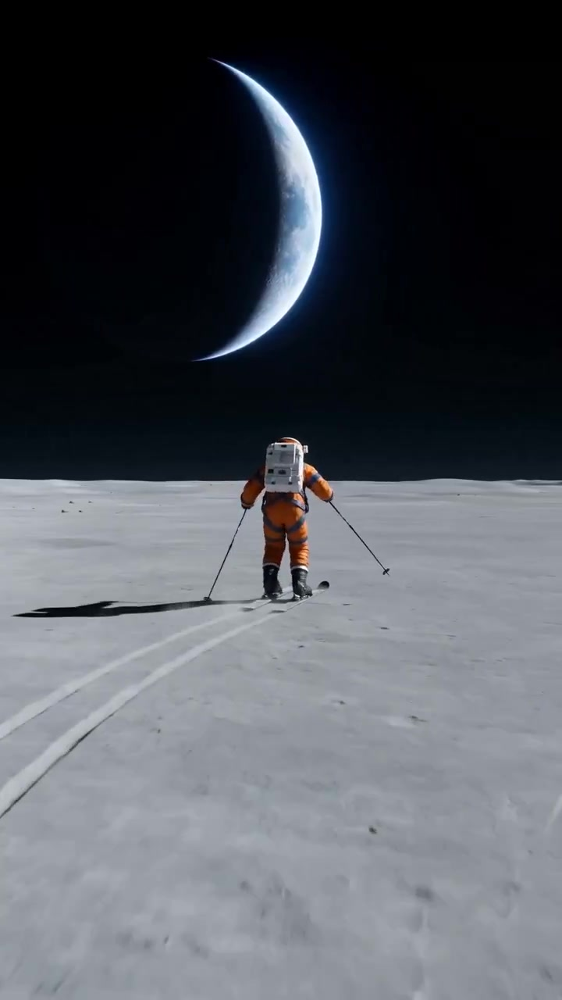
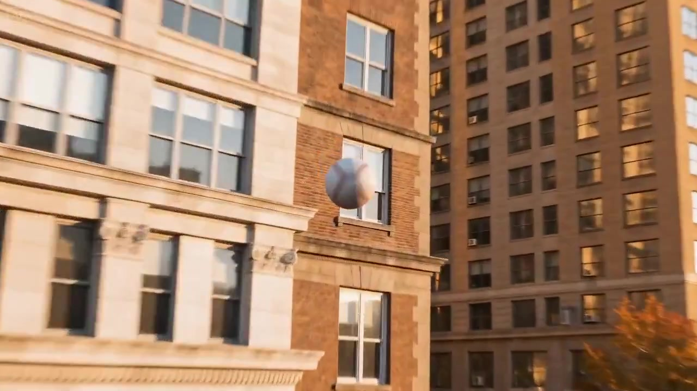

[](README.md) [](README_ja.md) [](README_ko.md) [](README_es.md)

<div align="center">
  

  # 🎬 Seedance 2.0 提示词合集

  **社区精选的 [Seedance](https://seed.bytedance.com/en/seedance2_0)（ByteDance）和 [MiniMax H3](https://seedanceprompt.io/prompts/model/minimax-h3) 视频提示词库**

  [](https://awesome.re)
  [](https://github.com/Ericgood/seedance-prompt)
  [](https://creativecommons.org/licenses/by/4.0/)
  [](https://github.com/Ericgood/seedance-prompt/pulls)

  **[浏览画廊](https://seedanceprompt.io)** | **[提交提示词](https://github.com/Ericgood/seedance-prompt/issues/new)**

</div>

---

## 🎬 什么是 Seedance 2.0？

**Seedance 2.0** 是由 **字节跳动 Seed 团队** 开发的多模态视频生成模型，于 **2026 年 2 月 10 日** 正式发布。它是业界首个支持 **四模态同时输入** 的模型——图片、视频、音频和文本——并原生支持音视频联合生成。

### 核心亮点

- 🏆 **AI Video Arena Elo 1,269** — 发布即超越 Google Veo 3、OpenAI Sora 2 和 Runway Gen-4.5
- 🎯 **@ 引用系统** — 最多绑定 9 张图片、3 个视频和 3 条音轨，实现精准创作控制
- 🔊 **原生音频同步** — 立体声输出，支持 8 种以上语言口型同步、对白、环境声和拟音，一次生成
- 🎬 **多镜头叙事** — 构建完整的电影级连续镜头序列，而非孤立片段
- 📷 **导演级运镜** — 推拉变焦、焦点转换、跟踪镜头、POV 切换、手持稳拍
- ⏱️ **最长 15 秒** — 主流竞品中单次生成时长最长
- 📐 **原生 720p** — 可升级至 1080p 和 2K

### 架构与参数

| 参数 | 详情 |
|:---|:---|
| **架构** | 双分支扩散 Transformer（联合视频帧 + 音频波形） |
| **开发者** | 字节跳动（Seed 团队）— 2026 年 2 月 10 日发布 |
| **分辨率** | 原生 720p，可升级至 1080p / 2K |
| **时长** | 每次生成 4、5、6、8、10、12 或 15 秒 |
| **输入模态** | 文本 + 图片 (x9) + 视频 (x3) + 音频 (x3)，通过 @ 标签引用 |
| **音频** | 立体声输出，支持 8 种以上语言口型同步、拟音和环境声 — 一次生成 |
| **生成模式** | 文生视频 (T2V)、图生视频 (I2V)、视频生视频 (V2V) |
| **使用平台** | CapCut、即梦 (Dreamina)、Spark、豆包、API |

### 竞品对比

| 模型 | Arena Elo | 最长时长 | 多引用输入 | 音频同步 |
|:---|:---:|:---:|:---:|:---:|
| **Seedance 2.0** | **1,269** | **15s** | **15 (9+3+3)** | **立体声** |
| Sora 2 (OpenAI) | ~1,220 | 12s | 2 | 单声道 |
| Kling 3.0 (快手) | ~1,248 | 10s | 2 | 单声道 |
| Veo 3.1 (Google) | ~1,200 | 8s | 1 | 支持 |
| Runway Gen-4.5 | ~1,180 | 10s | 1 | 不支持 |

*数据来源：[Artificial Analysis Video Arena](https://artificialanalysis.ai/) 及独立评测，2026 年。*

### 评测声音

> *"迄今最出色的模型"*，尤其在动态运动和物理模拟方面 — **CuriousRefuge**

> *"最显著的优势之一"* 是 @ 引用系统 — **Evolink AI**

> *"在实际测试中展现出真正实力"* — 音频同步能力 — **WaveSpeed AI**

**优势：** 业界最佳引用系统、出色的音频同步、卓越的多镜头叙事、电影级运镜控制、优秀的物理模拟。

**不足：** 原生分辨率 720p（可升级 2K）、学习曲线较陡（对操作方式敏感）、真实人脸内容审核严格、生成速度慢于部分竞品。

> *评测来源：[CuriousRefuge](https://curiousrefuge.com/blog/seedance-2-review) · [Evolink AI](https://evolink.ai/blog/seedance-2-review-best-ai-video-generator-2026) · [WaveSpeed AI](https://wavespeed.ai/blog/posts/seedance-2-0-review-issues-and-alternatives/)*

---

## 🎞️ MiniMax H3 提示词

收录创作者在 X 上分享的 MiniMax H3（又名海螺 H3 / Hailuo H3）真实提示词，每条都附生成的视频和原帖链接。在 **[seedanceprompt.io/zh/prompts/model/minimax-h3](https://seedanceprompt.io/zh/prompts/model/minimax-h3)** 浏览，或在 `prompts.json` 里按 `"model": "MiniMax H3"` 筛选。

## 📊 数据统计

<!-- STATS:START -->
| 提示词总数 | 精选 | 视频 | 最后更新 |
|:---:|:---:|:---:|:---:|
| **145** | **12** | **44** | 2026 年 10 月 |
<!-- STATS:END -->

---

<!-- LATEST:START -->
## 🆕 最新提示词

按时间倒序。完整提示词在 `prompts.json` 和每条提示词的页面里；版权归原作者。

| 日期 | 提示词 | 模型 | 作者 | 备注 |
|:---|:---|:---|:---|:---|
| 2026-10-25 | [企鹅米洛和巨型苹果 — 30秒3D动画喜剧](https://seedanceprompt.io/zh/prompts/milo-the-penguin-and-the-giant-apple-30s-3d-animated-comedy) | Seedance 2.5 | [@HeyAbhishek](https://x.com/HeyAbhishek/status/2114340975132950878) | 需要参考图 |
| 2026-10-23 | [看台恶作剧反转 — 电影感高中青春短片](https://seedanceprompt.io/zh/prompts/bleacher-prank-revenge-cinematic-high-school-teen-drama) | Seedance 2.5 | [@ZorayaAi](https://x.com/ZorayaAi/status/2113617700312559986) |  |
| 2026-10-20 | [逛街太无聊了 — 3D购物车喜剧](https://seedanceprompt.io/zh/prompts/when-shopping-gets-too-boring-3d-shopping-cart-comedy) | Seedance 2.5 | [@_YasirNFT](https://x.com/_YasirNFT/status/2112447279231602922) | 需要参考图 |
| 2026-10-17 | [海狸尼布斯和巨型树叶 — 30秒3D雨天喜剧](https://seedanceprompt.io/zh/prompts/nibs-the-beaver-and-the-giant-leaf-30s-3d-rainy-day-comedy) | Seedance 2.5 | [@HeyAbhishek](https://x.com/HeyAbhishek/status/2111428786914984092) | 需要参考图 |
| 2026-10-15 | [浣熊里科的野餐篮行动 — 30秒3D动画喜剧](https://seedanceprompt.io/zh/prompts/riko-the-raccoon-s-picnic-heist-30s-3d-animated-comedy) | Seedance 2.5 | [@HeyAbhishek](https://x.com/HeyAbhishek/status/2110718876459979208) | 需要参考图 |
| 2026-10-14 | [熊猫尼可过冰湖 — 30秒3D动画喜剧](https://seedanceprompt.io/zh/prompts/niko-the-panda-and-the-frozen-pond-30s-3d-animated-comedy) | Seedance 2.5 | [@HeyAbhishek](https://x.com/HeyAbhishek/status/2110355993255366802) | 需要参考图 |
| 2026-10-13 | [小熊猫科达和失控的大桃子 — 30秒3D冒险喜剧](https://seedanceprompt.io/zh/prompts/koda-the-red-panda-and-the-runaway-peach-30s-3d-adventure-comedy) | Seedance 2.5 | [@HeyAbhishek](https://x.com/HeyAbhishek/status/2109993586951663626) | 需要参考图 |
| 2026-10-12 | [Seoa 和她的猫 — 21:9 超宽画幅30秒科幻情感短片](https://seedanceprompt.io/zh/prompts/seoa-and-her-cat-30s-emotional-sci-fi-drama-in-21-9) | Seedance 2.5 | [@Alina_with_Ai](https://x.com/Alina_with_Ai/status/2109587461152395464) |  |
| 2026-10-11 | [地铁超能力救援 — 24秒韩式动作大片场景](https://seedanceprompt.io/zh/prompts/subway-supernatural-rescue-24s-korean-action-movie-scene) | Seedance 2.5 | [@Arzoo12sh](https://x.com/Arzoo12sh/status/2109234469832192156) |  |
| 2026-10-10 | [纽约一日自拍 Vlog — 角色一致性](https://seedanceprompt.io/zh/prompts/a-day-in-new-york-selfie-vlog-consistent-character) | Seedance 2.5 | [@EvoLinkAi](https://x.com/EvoLinkAi/status/2108809695087710283) | 需要参考图 |
| 2026-10-06 | [90年代美式餐厅时间静止 — 慢动作早餐打翻](https://seedanceprompt.io/zh/prompts/frozen-time-in-a-1990s-diner-slow-motion-breakfast-spill) | Seedance 2.5 | [@EvoLinkAi](https://x.com/EvoLinkAi/status/2107436379575840895) | 需要参考图 |
| 2026-10-05 | [黄昏公园长椅上，女子遇见温柔的白狮](https://seedanceprompt.io/zh/prompts/woman-meets-a-gentle-white-lion-on-a-park-bench-at-dusk) | MiniMax H3 | [@laviniavelle](https://x.com/laviniavelle/status/2106981798001680517) |  |
| 2026-10-04 | [磁悬浮列车穿越奇幻世界 — 30秒第一人称一镜到底](https://seedanceprompt.io/zh/prompts/maglev-ride-through-impossible-worlds-30s-first-person-one-shot) | Seedance 2.5 | [@HeyAbhishek](https://x.com/HeyAbhishek/status/2106710882567037394) |  |
| 2026-10-03 | [企鹅米洛过丛林急流 — 30秒3D动画喜剧](https://seedanceprompt.io/zh/prompts/milo-the-penguin-crosses-the-jungle-river-30s-3d-animated-comedy) | Seedance 2.5 | [@HeyAbhishek](https://x.com/HeyAbhishek/status/2106369769956065518) | 需要参考图 |
| 2026-10-02 | [浪漫夜晚主题香水广告（七个场景）](https://seedanceprompt.io/zh/prompts/romantic-evening-perfume-commercial-in-seven-scenes) | MiniMax H3 | [@CaliraVal](https://x.com/CaliraVal/status/2105895582275657852) |  |
<!-- LATEST:END -->

---

## 🏆 精选展示

精选提示词，展示 Seedance 2.0 的最强能力。

---

### 1. 🌙 宇航员月球滑雪


> 8K 照片级真实感 — 1/6 重力物理效果、尘雾、月球地平线上的新月形地球。

#### 📝 提示词

```
Wide shot. A lone astronaut in a dusty orange pressure suit with dark blue-gray harness
straps and black boots skis across a vast lunar plain, leaving two long parallel tracks
in the gray regolith behind. The astronaut is mid-stride, poles planted, pushing forward
in 1/6th gravity, each push sending the body drifting slightly upward before settling back.
Fine dust hangs in a low haze along the ski tracks. Behind and above, a crescent Earth sits
just over the soft curve of the lunar horizon, blue-white atmospheric glow against total
black sky. Raw sunlight, crushed shadows, no fill. 8K photorealistic. No logos on the suit.
```

<div align="center">
  <a href="https://media.seedanceprompt.io/videos/astronaut-moon-ski.mp4">
    
  </a>
  <br>
  <a href="https://media.seedanceprompt.io/videos/astronaut-moon-ski.mp4">📥 下载视频</a> ・ <a href="https://x.com/i/status/2041855477617713535">🐦 来源</a>
</div>

---

### 2. 🧛 吸血鬼公主变身


> 全引用大师课 — 5 个不同镜头，从温馨日常到哥特吸血鬼与血月，展示多镜头叙事和特效转场。

#### 📝 提示词

```
镜头一：日常居家 时间段：0:00 至 0:02 中景手持跟拍，女孩穿蜡笔小新睡衣，拿纸望远镜
对准镜头做转场。镜头二：时空隧道转场 0:02-0:04 深红漩涡虫洞效果，极速推进。
镜头三：吸血姬降临 0:04-0:06 白发精灵耳白色华服，慢动作红色花瓣飘落。
镜头四：魅惑定格 0:06-0:09 Glitch故障风、径向模糊、高饱和红色背景。
镜头五：血月飞翔 0:09-0:12 恶魔双翼悬浮夜空，巨大血月背景。
```

<div align="center">
  <a href="https://media.seedanceprompt.io/videos/vampire-transformation.mp4">
    
  </a>
  <br>
  <a href="https://media.seedanceprompt.io/videos/vampire-transformation.mp4">📥 下载视频</a> ・ <a href="https://x.com/i/status/2042124667910008998">🐦 来源</a>
</div>

---

### 3. ☀️ 清晨城市氛围


> 多镜头生活切片 — 邮递员、面包师、咖啡师、手风琴演奏者、花贩、街头画家。温暖的欧洲清晨氛围。

#### 📝 提示词

```
Morning city ambience, people walking, cars driving, bikes riding.
[cut] The mailman on the bike drops a newspaper into the mailbox.
[cut] The baker places the buns on the counter.
[cut] The man playing the accordion on the street.
[cut] The woman pushing the baby stroller.
[cut] The barista making coffee.
[cut] The man playing the flute to his dog.
[cut] The man selling tulips on the street.
[cut] The man painting on the street.
```

<div align="center">
  <a href="https://media.seedanceprompt.io/videos/morning-city-ambience.mp4">
    
  </a>
  <br>
  <a href="https://media.seedanceprompt.io/videos/morning-city-ambience.mp4">📥 下载视频</a> ・ <a href="https://x.com/i/status/2038619621419569552">🐦 来源</a>
</div>

---

### 4. 🦛 Kit Kat 河马 — 连续跟踪长镜头


> 单镜头跟球拍摄 — 从黄金时刻的街道穿过窗户进入一间奢华房间，揭示一只穿浴袍吃巧克力的河马。荒诞冷面风格广告杰作。

#### 📝 提示词

```
Over the shoulder of a young man in a beanie and jacket on a wet urban street at golden
hour. He winds up and hurls a baseball toward the building across the street. The camera
stays attached to the ball as it spins forward crossing the street, rises toward the facade,
passes through a window with glass parting gently around it catching golden light. The ball
continues through the interior of an opulent wood-paneled room, glides over a herringbone
parquet floor scattered with red chocolate wrappers and foil. The ball slows, rolls past
the foot of a velvet sofa and settles on the floor. The camera drifts upward from ball
level revealing a massive hippo in a white bathrobe reclining on the sofa surrounded by
red chocolate bars. He glances down at the ball with lazy curiosity, looks away and keeps
chewing. Hold. Hyper-realistic cinematic single continuous shot, warm golden hour exterior
transitioning seamlessly to rich amber interior. Anamorphic look. Deadpan surreal payoff.
```

<div align="center">
  <a href="https://media.seedanceprompt.io/videos/kitkat-hippo-ad.mp4">
    
  </a>
  <br>
  <a href="https://media.seedanceprompt.io/videos/kitkat-hippo-ad.mp4">📥 下载视频</a> ・ <a href="https://x.com/i/status/2041236549317378556">🐦 来源</a>
</div>

---

### 5. 🃏 赌场扑克牌飞行 — 15 秒 POV


> 15 秒扑克牌视角电影：从性感荷官手中出发，穿越螺旋楼梯、大厅，最终抵达神秘手牌。展示复杂运镜跟踪和多镜头叙事。

#### 📝 提示词

```
15秒赌场扑克牌飞行视频，黑桃K从性感女荷官手中飞出，以紧跟牌的视角穿越整个豪华赌场。
镜头1：女荷官上半身特写，手持黑桃K，牌正面朝向镜头。
镜头2：牌弹出瞬间，紧跟牌背面视角快速掠过赌桌区。
镜头3：牌沿螺旋楼梯弧线轨迹上升。
镜头4：牌高速直线穿越走廊。
镜头5：牌从二楼俯冲进入大堂。
镜头6：牌减速从玩家后方下面接近。
镜头7：牌悄悄传递到手中，翻转展示黑桃K正面。
镜头8：切回女荷官自信微笑特写。
写实风格、电影级质感、高速摄影、运动模糊、戏剧性打光。
```

<div align="center">
  <a href="https://media.seedanceprompt.io/videos/casino-card-flight.mp4">
    
  </a>
  <br>
  <a href="https://media.seedanceprompt.io/videos/casino-card-flight.mp4">📥 下载视频</a> ・ <a href="https://x.com/i/status/2040738604188623155">🐦 来源</a>
</div>

---

## 🤝 如何贡献

欢迎所有人提交提示词！

### 通过 Pull Request 提交

1. **Fork** 本仓库
2. 提供 **视频** 的原帖链接（视频由我们的媒体服务器托管，不放在本仓库），缩略图添加到 `assets/thumbnails/`
3. 在 `prompts.json` 中 **添加** 你的提示词条目
4. **提交 PR** — 我们会审核并合并！

### 通过 Issue 提交

不想处理 PR？直接 [创建 Issue](https://github.com/Ericgood/seedance-prompt/issues/new)，包含以下内容：

- 你的提示词文本
- 视频文件或链接
- 生成效果描述
- 你的名字或账号（用于署名）

### 提示词数据格式

`prompts.json` 中每条记录的格式：

```json
{
  "id": "your-prompt-id",
  "title": "Your Prompt Title",
  "title_zh": "你的提示词标题",
  "prompt": "Your full prompt text...",
  "description": "Brief description of the output",
  "description_zh": "输出的简要描述",
  "category": "Cinematic",
  "tag": "Cinematic",
  "tag_zh": "电影级",
  "tagColor": "#FF4D00",
  "model": "Seedance 2.0",
  "author": "Your Name",
  "source": "https://x.com/...",
  "video": "videos/your-video.mp4",
  "thumbnail": "assets/thumbnails/your-video.jpg",
  "featured": false,
  "date": "April 2026"
}
```

### 提交指南

- ✅ 你原创或有权分享的提示词
- ✅ 注明所用模型（Seedance 2.0）
- ✅ 添加预期输出的描述
- ✅ 强烈建议附带视频/缩略图预览
- ❌ 禁止 NSFW 内容
- ❌ 禁止复制受版权保护的角色

---

## ⚠️ 声明

Seedance Prompt 是独立的非官方提示词库，与字节跳动（ByteDance）和 MiniMax 均无隶属、背书或赞助关系。Seedance、MiniMax 是其各自权利人的商标。

## 📜 许可证

<!-- LICENSE-NOTE -->
我们自己整理的部分——标题、描述、分类和本 README——采用 [CC BY 4.0](https://creativecommons.org/licenses/by/4.0/) 许可。**CC BY 4.0 不覆盖提示词原文和视频**：它们的版权归 X 上的原作者，每一条都附原帖链接。如果你是原作者并希望删除某条内容，请[提 issue](https://github.com/Ericgood/seedance-prompt/issues/new)，我们会下架。

## 🌐 相关链接

- 🎬 [Seedance 2.0 官方](https://seed.bytedance.com/en/seedance2_0) — 字节跳动 Seed 团队
- 🌐 [seedanceprompt.io](https://seedanceprompt.io) — 以视觉画廊方式浏览提示词
- 📊 [Artificial Analysis Video Arena](https://artificialanalysis.ai/) — 模型排名
- 📝 [CuriousRefuge 评测](https://curiousrefuge.com/blog/seedance-2-review) — "迄今最出色的模型"
- 📝 [Evolink AI 评测](https://evolink.ai/blog/seedance-2-review-best-ai-video-generator-2026) — 全面功能分析
- 📝 [WaveSpeed AI 评测](https://wavespeed.ai/blog/posts/seedance-2-0-review-issues-and-alternatives/) — 问题与替代方案
- 💬 [讨论区](https://github.com/Ericgood/seedance-prompt/discussions)
- 🐛 [问题反馈](https://github.com/Ericgood/seedance-prompt/issues)

## 🙏 致谢

- 提示词数据来源于 [awesome-seedance-2-prompts](https://github.com/YouMind-OpenLab/awesome-seedance-2-prompts) (CC BY 4.0)
- 所有原创提示词作者均在各条目中署名
- 感谢字节跳动 Seed 团队开发 Seedance 2.0

---

<div align="center">

**如果觉得有用，请给我们一个 ⭐！**

由 Seedance Prompt 社区用 ❤️ 打造

</div>
